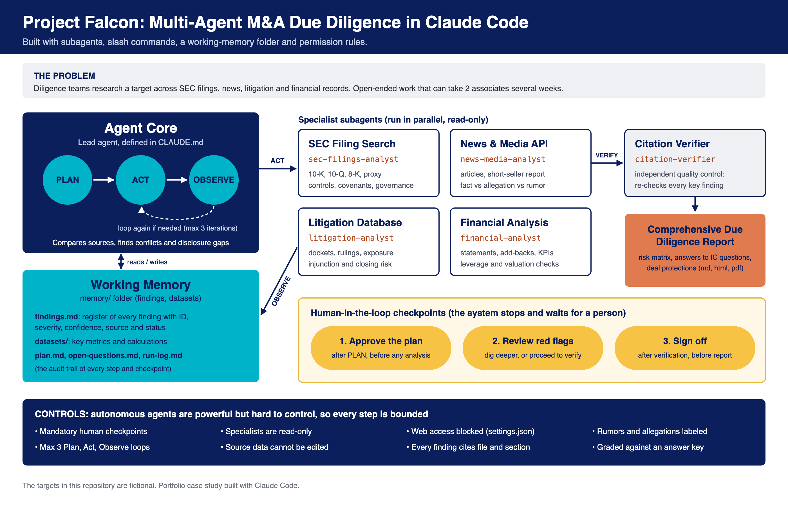

# Mergers and Acquisitions due diligence

**Project Falcon:** a multi-agent M&A due diligence system, built in Claude Code.

> **Portfolio case study.** An AI "diligence team" that researches an acquisition target across SEC filings, news, litigation records and financial data, then writes an Investment Committee report.
>
> All companies, people, court cases, articles and numbers are **fictional**.

## Watch the demo (90 seconds)

https://github.com/user-attachments/assets/450abcdb-cfa0-407d-87a8-71409df9f3e5

A blind run on Plover, a company the system had never seen: the plan, four analysts, the red flags, the verifier and the report, then the graded results. The scenes are recreated from that run's saved output in [`runs/2026-10-31_0946/`](runs/2026-10-31_0946/), with my own voice-over.



## At a glance

- **The task:** due diligence on Talonfield Systems, a (fictional) public robotics company that Arbelion Industries wants to buy for $24.00 per share (about $1.16 billion).
- **The team:** one lead agent and five specialist subagents, running a bounded **Plan -> Act -> Observe** loop.
- **The controls:** three mandatory human checkpoints, read-only specialists, an independent citation verifier, an iteration cap and blocked web access.
- **The proof:** the fictional data contains 18 planted red flags. A built-in answer key and an `/evaluate` command grade how many the system finds.
- **Built like a product:** a product spec, design spec, tech spec and phased plan, each agreed before building, with automated checks for every phase.
- **Results:** across three fully blind graded runs, each in a fresh session that never saw the answer key, the system averaged 97.4% recall on the 13 Critical and High planted issues (range 96.2% to 100%) and 93.5% on all 18, with no unsupported finding in any report and no distractor rated too high. A fourth blind run, after fixing the gaps those three exposed, found all 18 (100%). A fifth, after quality fixes, kept 100% on Critical and High issues while cutting the report from 38 pages to 17 and the risk matrix from 90 rows to 14. A sixth found all 18 again, in a 13-page report. An earlier, partly blind test run is kept as a [sample](examples/sample-run/evaluation/scorecard.md). On three new fictional targets it still found every planted issue's facts and put nothing unsupported in a report. On Heron, built blind, it found all 18, and exact severity judgment (77.8%) was the gap. On Plover, a fourth target built blind to test the calibration rules added after that, it found all 18 again, matched 16 of 18 severities exactly (88.9%) and rated no distractor too high. On Wren, a fifth target built outside the project so its builder never saw the instructions, and graded by a separate session, it found 13 of 13 Critical and High issues (97.2% overall); of the three rules Plover's grade led to, one fully worked and two partly, and exact severity fell to 72.2% (see [Does it generalize?](#does-it-generalize-four-new-targets)).

## The problem

During M&A due diligence, teams must research target companies across multiple databases, public filings, news, litigation history and financial records. This open-ended investigation can take weeks for teams of 5 to 10 associates. Autonomous agents can help, but they are the hardest AI pattern to control, so high-stakes work needs human checkpoints.

## How the architecture maps to Claude Code

| Architecture component | Built with | Files |
|---|---|---|
| **Agent Core** (Plan -> Act -> Observe) | Lead agent instructions | `CLAUDE.md` |
| **SEC Filing Search** | Subagent + simulated filings | `.claude/agents/sec-filings-analyst.md`, `targets/<target>/data/sec-filings/` |
| **News & Media API** | Subagent + simulated news feed | `.claude/agents/news-media-analyst.md`, `targets/<target>/data/news/` |
| **Litigation Database** | Subagent + simulated court dockets | `.claude/agents/litigation-analyst.md`, `targets/<target>/data/litigation/` |
| **Financial Analysis** | Subagent + financial data | `.claude/agents/financial-analyst.md`, `targets/<target>/data/financials/` |
| **Working Memory** (findings, datasets) | A folder of Markdown files | `memory/` |
| **Comprehensive Due Diligence Report** | Report step with a print stylesheet, a committed converter and headless Chrome for the PDF | `output/`, `templates/report-style.css`, `tools/md2html.py` |
| **Human-in-the-loop checkpoints** | Three mandatory stops | `CLAUDE.md` |
| Added: quality control | Independent citation verifier | `.claude/agents/citation-verifier.md` |
| Added: guardrails | Permission rules (no web, read-only data) | `.claude/settings.json` |
| Added: evaluation | Answer key per target and grading command | `targets/<target>/evaluation/`, `/evaluate` |
| Added: committee dashboard | A read-only page made after a run: findings by severity and status, top red flags, key metrics, open questions | `tools/make_dashboard.py` |
| Added: one-word commands | Slash commands | `.claude/commands/` |

## How a run works

1. **Plan.** The lead agent reads the deal brief, maps the Investment Committee's six questions to the analysts, writes hypotheses and a task list to `memory/plan.md`. **Checkpoint 1: a human approves the plan.**
2. **Act.** Four specialists work in parallel, each on its own source, and return findings in a standard format: ID, evidence, source, severity, confidence and what to cross-check.
3. **Observe.** The lead agent records every finding in the findings register, then compares sources. Most of the serious issues only appear here: a court ruling the company's filing leaves out, a one-off revenue amount from a footnote that changes the growth story, a deal model built on guidance that was later cut. It loops again only if a Critical or High question is still open (maximum 3 loops). **Checkpoint 2: a human reviews the red flags and decides whether to dig deeper.**
4. **Verify.** An independent citation verifier re-opens every cited source and re-checks every Critical and High finding. **Checkpoint 3: a human signs off.**
5. **Report.** The lead agent writes the report: a recommendation, the top red flags, answers to the six IC questions, a risk matrix, cross-source insights, deal protections and a management request list.

## Design choices

- **Specialists by source, not by topic.** This mirrors the architecture's tools and forces the important work, connecting sources, into the lead agent's Observe step.
- **Separation of duties.** Analysts cannot edit anything. A separate verifier checks their work, like a reviewer on a real deal team.
- **Severity and confidence are separate.** A rumor can matter a lot and still be unconfirmed. The report labels facts, allegations and rumors.
- **Memory as plain files.** Anyone can open `memory/` and audit every finding, decision and checkpoint. The run survives a restart.
- **Bounded autonomy.** A 3-loop cap, stop conditions and human checkpoints keep the agents on a short leash.
- **Measured, not assumed.** Planted issues and an answer key turn "it seems to work" into a score you can improve.

## How it was planned and tested

- **Project Memory:** the [product spec](Project%20Memory/product-spec.md) (34 requirements), [design spec](Project%20Memory/design.md), [tech spec](Project%20Memory/tech-spec.md) (architecture, data model and 11 critical risks) and the phased [plan](Project%20Memory/progress.md), each agreed before building. They are also published as a [website](https://claude.ai/artifact/CmFqn6PUnPvRse4GxpLrDW) with live plan ticks.
- **Automated checks:** 69 checks using only Python's standard library, for every phase: read-only agents and guardrails, data that ties out and has not changed (for every target), complete runs and reports, graded scorecards, the committee dashboard, the real-filings download tool and house style. Type `/run-tests`, or run `python3 tests/run_all.py`. Add `--run examples/sample-run` to check the saved run.
- **One-page case study:** [docs/case-study.pdf](docs/case-study.pdf).

## Sample run

A complete test run from October 18, 2026 is saved in [`examples/sample-run/`](examples/sample-run/).

**Proposed recommendation: do not proceed at $24.00 per share.** At the deal model's own multiple, current guidance supports $12.60 to $14.50 per share. The three Critical issues: a valuation built on guidance the target had already replaced, a patent case that turned against the target (with an injunction sought on robots behind about 42% of revenue), and a 31% customer that can leave after a change of control. Read the [report (PDF, 15 pages)](examples/sample-run/output/Project-Falcon-Due-Diligence-Report.pdf).

| Step | What happened |
|---|---|
| Plan | 6 IC questions and 4 hypotheses; approved at Checkpoint 1 |
| Iteration 1 | 4 analysts in parallel: 59 findings. The lead agent added 15 cross-source findings and 5 conflicts between sources |
| Iteration 2 | 5 narrow follow-ups (covenant headroom, what the 10-Q leaves out, normalized revenue and valuation): 15 more findings |
| Verify | 61 findings re-checked by 4 verifier runs in parallel: 44 verified, 17 corrected, 0 rejected |
| Report | Approved at Checkpoint 3. 69 minutes from plan to sign-off; 10 subagent runs; about 1.95 million subagent tokens |

**Scorecard** (graded with `/evaluate` against the answer key):

| Metric | Result | Target |
|---|---|---|
| Recall, the 13 Critical and High planted issues | 100% | at least 80% |
| Recall, all 18 planted issues | 97.2% (17 found, 1 partially found) | |
| Severity within one level of the answer key | 100% | |
| Unsupported findings in the report | 0 | 0 |
| Distractors rated Medium or above | 0 of 4 | 0 |

**What the evaluation changed.** The one partial miss (goodwill impairment risk) was found by three agents but never reached the report, because only higher-severity findings were verified. That, a trend spread across five findings and verifier corrections applied late became three fixes to `CLAUDE.md`, applied after this run.

**How blind was it?** The analysts and verifiers never saw the answer key. The lead agent ran in the same Claude Code session that built the data, and the checkpoints were approved by the builder. The three graded runs below fix that: each ran in a fresh session.

**Three blind graded runs.** After the three fixes, I ran the system three more times, each in a fresh Claude Code session that never saw the answer key or an earlier run. The setup was frozen across the three, so the scores measure how much results vary from run to run.

| Metric | Run 1 | Run 2 | Run 3 | Average | Range |
|---|---|---|---|---|---|
| Recall, the 13 Critical and High planted issues | 96.2% | 96.2% | 100% | 97.4% | 96.2% to 100% |
| Recall, all 18 planted issues | 94.4% | 91.7% | 94.4% | 93.5% | 91.7% to 94.4% |
| Severity within one level of the answer key | 100% | 100% | 100% | 100% | |
| Unsupported findings in the report | 0 | 0 | 0 | 0 | |
| Distractors rated Medium or above | 0 of 4 | 0 of 4 | 0 of 4 | 0 | |

The same gaps showed up more than once: goodwill impairment risk was only partly found in all three runs, the planted positives were thin in every report, and a lawsuit by the #4 customer was not linked to that customer's revenue in two of the three. Those became the next instruction fixes. Run 2's own scorecard reports 96.4% because it counted 14 Critical and High issues; the table recomputes every run on the answer key's 13. Scorecards: [run 1](runs/2026-10-18_0921/evaluation/scorecard.md), [run 2](runs/2026-10-18_1336/evaluation/scorecard.md), [run 3](runs/2026-10-18_1741/evaluation/scorecard.md).

**Run 4: measuring the fixes.** I then applied the fixes the three runs pointed to and gave `/evaluate` a fixed grading rule:

- size every named customer, supplier or litigant against the customer data;
- verify every Medium finding the report relies on;
- put the strengths in the executive summary;
- compare the last goodwill test with the share price since.

Then I ran a fourth blind run in a fresh session.

| Metric | Runs 1 to 3 (average) | Run 4 (with fixes) |
|---|---|---|
| Recall, the 13 Critical and High planted issues | 97.4% | 100% |
| Recall, all 18 planted issues | 93.5% | 100% |
| Severity within one level of the answer key | 100% | 100% |
| Unsupported findings in the report | 0 | 0 |
| Distractors rated Medium or above | 0 | 0 |

All three repeated gaps closed:

- Pinecrest is now sized as the #4 customer ($17.4M).
- The LiDAR and tariff risk is combined across sources and verified.
- Goodwill risk is tied to the share price fall and verified.
- Strengths have their own section in the executive summary.

**Caveats.** This is one run with the fixes, not an average, so it shows the fixes work, not how much the result varies. Run 4 was graded in the session that produced it, which is the same practice as runs 1 to 3.

**The next problems are about quality, not recall:**
- Severity drift: three High issues were rated Critical.
- The verifier corrected 9 of the lead agent's 19 cross-source findings.
- A 90-row risk matrix full of duplicates.

Scorecard: [run 4](runs/2026-10-18_1909/evaluation/scorecard.md).

**Run 5: measuring the quality fixes.** I made three changes for quality, not recall: a Critical rating must name the test it meets and show the number; the lead agent self-checks each cross-source finding before verification; and duplicate findings are folded into one parent finding, so the risk matrix shows each fact once. Then I ran a fifth blind run in a fresh session.

| Metric | Run 4 | Run 5 (quality fixes) |
|---|---|---|
| Recall, the 13 Critical and High planted issues | 100% | 100% |
| Recall, all 18 planted issues | 100% | 97.2% |
| Severity within one level of the answer key | 100% | 100% |
| Unsupported findings in the report | 0 | 0 |
| Distractors rated Medium or above | 0 | 0 |
| Critical issues in the report | 11 labels | 3 |
| Cross-source findings the verifier corrected | 9 of 19 | 5 of 14 |
| Risk matrix rows | 90 | 14 |
| Report length | 38 pages | 17 pages |

Every quality target was met, and Critical and High recall held. The cost was half a point on goodwill risk: it was found again, but as a Medium finding that no answer cited, so it was never verified. The run also showed three process gaps, all fixed afterwards: the Checkpoint 1 plan summary was not shown in chat, one verifier's headline count did not match its own table, and the run wrote its own report converter, which is now committed as `tools/md2html.py`.

Scorecard: [run 5](runs/2026-10-18_2316/evaluation/scorecard.md).

**Run 6: closing the last gap.** Run 5 lost half a point on goodwill because a Medium finding that no answer cited was never verified. Two general changes followed: verify every Medium finding the report shows, and compare each dated accounting judgment (an impairment test, a reserve) with what happened afterwards. They were written by a builder session that had never opened the answer key. Then I ran a sixth blind run.

| Metric | Run 5 | Run 6 |
|---|---|---|
| Recall, the 13 Critical and High planted issues | 100% | 100% |
| Recall, all 18 planted issues | 97.2% | 100% |
| Severity within one level of the answer key | 100% | 100% |
| Unsupported findings in the report | 0 | 0 |
| Distractors rated Medium or above | 0 | 0 |
| Cross-source findings the verifier corrected | 5 of 14 | 7 of 13 |
| Risk matrix rows | 14 | 18 |
| Report length | 17 pages | 13 pages |

Goodwill risk was tied to events after the test date and verified, so all 18 issues are found again. The run 5 process fixes held: every checkpoint was shown in chat, and the report used the committed converter. Two small things slipped: the verifier corrected more cross-source findings, and six unverified Low findings got a non-standard status, which one automated check flags.

Scorecard: [run 6](runs/2026-10-19_0903/evaluation/scorecard.md).

Inside the run: the [findings register](examples/sample-run/memory/findings.md), the [run log](examples/sample-run/memory/run-log.md) with all three checkpoints, every analyst's [unedited report](examples/sample-run/memory/analyst-reports/), the [verifier reports](examples/sample-run/memory/verification/) and the [scorecard](examples/sample-run/evaluation/scorecard.md).

## Does it generalize? Four new targets

Six runs on one dataset can overstate how good a system is, because its instructions were tuned on that data. So I tested it on four new fictional targets, each in its own folder under `targets/`, graded the same way.

- **Kestrel** (a clinical-lab company in a private equity take-private) was built by a session that never saw Falcon's answers. But it could read the system's instructions, and most of its planted issues turned out to be the same types as Falcon's, so it is a near-transfer test.
- **Heron** (a smart-home company) was built by a session that never saw the instructions or the other targets, from issue types neither of the others uses: product safety, a pension cash call on change of control, a privacy order, disputed patent ownership, sanctions, transfer pricing and more. It is the held-out test, and the setup was frozen until it was graded.
- **Plover** (an outdoor apparel brand, the target of a private equity topping bid) was built by a session that never saw the other targets or their answer keys and was told to avoid every issue type they use. It was less blind than Heron in one way: its builder started inside the project, so it could read the system's instructions. It tests the rules added after Kestrel and Heron on data they were not written from, and the setup was frozen again until it was graded.
- **Wren** (an elevator maintenance company in a private equity take-private) was built by a session started in an empty folder outside the project, so the instructions could not load, and told to avoid every issue type the other four use. It plants three items that test the rules added after Plover. A fresh session ran it blind, and a different session graded it.

| Metric | Falcon run 6 (tuned) | Kestrel run 1 (near transfer) | Heron (held out) | Plover (held out, new rules) | Wren (held out, Plover's rules) |
|---|---|---|---|---|---|
| Planted issues whose facts were found | 18 of 18 | 18 of 18 (one only as a note) | 18 of 18 | 18 of 18 | 18 of 18 (one Low only partly) |
| Recall, the 13 Critical and High issues | 100% | 100% | 100% | 100% | 100% |
| Recall, all 18 issues | 100% | 97.2% | 100% | 100% | 97.2% |
| Severity within one level of the answer key | 100% | 100% | 100% | 100% | 100% |
| Severity, exact match | not measured | not measured | 77.8% (14 of 18) | 88.9% (16 of 18) | 72.2% (13 of 18) |
| Unsupported findings in the report | 0 | 0 | 0 | 0 | 0 |
| Distractors rated Medium or above | 0 of 4 | 2 of 4 | 1 of 4 | 0 of 4 | 1 of 4 |

**How to read Heron's score.** The system found the facts of every planted issue on a target it had never seen, and put nothing unsupported in the report. Scores use the grading rule the owner chose: an issue counts as found when its main point is verified with a severity within one level of what the answer key accepts, and exact severity matches are reported separately. On that rule Heron is 100% recall, with 14 of 18 severities (77.8%) an exact match; four were one level off (for example a product-safety issue rated High instead of Critical). Heron's original grader used a stricter reading that counted those four as partly found (88.5% on Critical and High issues); the rule was made exact afterwards so every run is graded the same way. What did not carry over cleanly is judgment: exact severity on unfamiliar issue types, and one distractor (pre-planned share sales by the CFO) rated as a red flag.

**What happened after each grade.** After Kestrel run 1 and after Heron, new rules were added from their scorecards (commits `af02fce` and `78827d5`). A Kestrel rerun with those rules scored 100% with 0 distractors too high, but that is an in-sample result, measured on the target the rules came from, so it does not count as generalization. The honest test of the new rules is a fourth target built blind: Plover.

**How to read Plover's score.** Plover was built to give the new rules an out-of-sample test. It included an issue sized by a remedy a regulator formally seeks and two distractors already neutralized by a contract or an accounting treatment. The system rated the regulator's refund claim Critical at its computed upper bound (US$212.5 million, from the company's own revenue data), listed both neutralized distractors as mitigants, and rated no distractor too high. Exact severity rose to 88.9% (16 of 18), from Heron's 77.8%. Both misses were one level too high: deal costs from equity that vests at closing, and a customer-cost metric that a broader trend finding repeated. One of the eight planted strengths (effective controls and a long-serving auditor) was not credited, and the run passed all 49 automated checks. Caveats: it is one run on one target; three of Plover's 18 issues are close cousins of earlier types (a one-time reserve release, a sales spike into a customer already holding heavy stock, and deal costs from equity vesting), so they are not fully out-of-sample; the grade was made by the session that ran the diligence, which opened the answer key only after the report was written; and on a stricter reading of one issue, exact severity would be 83.3%.

**How to read Wren's score.** Wren measured the three rules Plover's grade led to, each planted as a test item and graded first. One worked: effective controls and a long-serving auditor were listed as a qualified positive that names the finding putting them in doubt. Two worked in part. Known deal costs were put in the price with the three amounts right, but the run added an advisor's fee, measured the 5% test against equity value instead of enterprise value, and so rated the total High instead of Medium. A trend kept its separate accounting judgment as its own row, as the rule asks, but was rated High instead of Critical because the run never valued the earnings decline at the deal multiple. Exact severity fell to 72.2% (13 of 18), all five misses one level off, and an anonymous, denied rumor was rated Medium with its own risk row. Caveats first: it is one run; the target was built to contain the three test items, so it is a targeted test of those rules, not a natural sample; and, unlike Plover, it was graded by a session that did not run the diligence, so part of the lower exact-severity score may come from a stricter grader rather than a weaker run. Its scorecard suggests three generic rule changes, to be written by a session that has not seen the answer key and measured on a later run.

Scorecards: [Kestrel run 1](runs/2026-10-19_1449/evaluation/scorecard.md), [Kestrel rerun, in-sample](runs/2026-10-19_1614/evaluation/scorecard.md), [Heron](runs/2026-10-19_1711/evaluation/scorecard.md), [Plover](runs/2026-10-31_0946/evaluation/scorecard.md) (and its [report](runs/2026-10-31_0946/output/Project-Plover-Due-Diligence-Report.pdf)), [Wren](runs/2026-11-02_2237/evaluation/scorecard.md) (and its [report](runs/2026-11-02_2237/output/Project-Wren-Due-Diligence-Report.pdf)).

## Repository structure

```
CLAUDE.md                  Lead agent: the Plan -> Act -> Observe loop, checkpoints, report template
.claude/
  agents/                  5 subagents (4 source specialists + citation verifier)
  commands/                /diligence, /diligence-status, /evaluate, /reset-memory, /run-tests
  settings.json            Guardrails: no web access, sources read-only, approval to open any evaluation/ folder or earlier runs
targets/                   One folder per fictional diligence target, for example targets/falcon/:
  falcon/data/             Simulated sources: filings, news, dockets, financials, deal brief
  falcon/evaluation/       Answer key of planted issues (+ scorecard after /evaluate)
  falcon/data_manifest.json  Checksums that prove the sources and answer key are unchanged
  falcon/checks.json       Optional target-specific expectations for the checks
memory/                    Working memory (blank, ready for your run)
templates/                 Blank memory files, the report stylesheet and the rules for a real company
tools/md2html.py           Report converter: Markdown to self-contained HTML (Python standard library)
tools/fetch_edgar.py       Downloads a real company's SEC filings as of a cutoff date, for the real-filings backtest (Phase 8)
tools/make_dashboard.py    Committee dashboard: a finished run's memory as one read-only HTML page (Python standard library)
output/                    Where the report and the dashboard are written
examples/sample-run/       A complete test run: memory, report (PDF) and scorecard
tests/                     69 automated checks (Python standard library), run with /run-tests
Project Memory/            Product spec, design spec, tech spec and phased plan
docs/                      Architecture diagram, run guide, one-page case study
```

## Run it yourself

Open the folder in Claude Code and type `/diligence` (or `/diligence <target>` for a target other than `falcon`). Reply at the three checkpoints. Full guide: [docs/how-to-run.md](docs/how-to-run.md).

After the run, `python3 tools/make_dashboard.py` writes a read-only committee dashboard to `output/`: findings by severity and verification status, the top red flags, the key metrics and the open questions, copied from working memory so they match the report. See it for two graded runs: [Wren](https://claude.ai/artifact/Y3gKcZJcGj2RYoZ6kMwF9H) and [Plover](https://claude.ai/artifact/CDPEoYoYgjDuXnHghJyJqi) (live pages; the files are in each run's `output/` folder).

For a truly blind test, start a fresh Claude Code session in the folder, run `/diligence`, then `/evaluate` and compare your scorecard with the sample run. Claude Code asks before any agent can open the answer key, a scorecard or an earlier run.

## Real companies: two backtests

The fictional targets test the system on issues someone planted. A backtest tests it on real SEC filings, where nobody planted anything. For each backtest, a download tool (`tools/fetch_edgar.py`) saved one real public company's filings and EDGAR's structured financial data as of a cutoff date into a target folder. The agents stayed offline and read-only. The deal is hypothetical. News and litigation stayed empty, because made-up news or court records about a real company are not acceptable, and the report lists them as gaps. The answer key lists warning signs that were visible in the filings before the cutoff and that the later public record shows mattered.

**Limits first.** Each backtest is one company, picked by a separate session that knew the later record. I knew each company's name, so I approved each checkpoint without steering. The answer keys have 10 and 8 warning signs and no distractors, so they cannot show false alarms. Part of backtest-1's run log used estimated times, so run time is not measured. The companies, the full reports and the scorecards stay private: they are an AI's red-flag list about a real, named company, and AI output can still be wrong.

| Target, set before the run | Backtest-1 (cutoff in 2018) | Backtest-2 (cutoff in 2014) |
|---|---|---|
| At least 2 in 3 of the warning signs found | 10 of 10 | 5 of 8, plus 3 partly found (81.3% scored, 62.5% on full finds alone) |
| The sign most tied to the later event is in the top five red flags | Yes, third | Yes, second |
| Unsupported findings in the report | 0 | 0 |
| Hindsight leaks (anything dated after the cutoff) | 0 | 0 |
| Three checkpoints held, nine report parts, empty sources listed as gaps | Yes | Yes |

**Backtest-1.** Severity matched the answer key exactly on all 10. The warning signs were about one large related-party loan to insiders: no allowance, repeated modifications, no cash collected, a bonus used to pay it down, collateral in the company's own shares, a partial asset sale, management's "no risk of loss" judgment, unpaid interest booked as income, a material weakness in controls, and board control by the borrowers. The grader still found three weak spots. The run did not test a write-off against equity and restatement risk. It counted share collateral valued at the buyer's own offer price as a positive. And it kept the control weakness apart from the transactions it could affect. Those became three generic rules, written by a session that never saw the answer key.

**Backtest-2.** It met the first target on the grader's score, where a partial find counts half, but not on full finds alone, which fall just under 2 in 3. I report both. Severity was within one level on all 8 and exact on 7 (one was rated a level high). The warning signs were an unrecorded tax liability and its growth after the examined years, a loss contingency judgment whose wording changed between filings, the quality of revenue and earnings, restatement risk for earlier periods, internal controls, and management and board turnover. The three partial finds share one gap: the run sized the liability going forward but did not follow it back. It did not tie the growth driver to the earnings the deal is priced on. It named a restatement risk only for the latest quarter, not the earlier audited years. And it set the controls conclusion against disclosure errors rather than against the practice behind the liability. Backtest-1's rules had little to act on here (no related-party loan, no share collateral, no reported control weakness), so backtest-2 measured the system on a new kind of problem more than it measured those rules. Its three weak spots are now rules too, but they were written by the session that graded the run, after it read the answer key. So both sets of rules are unmeasured, and the next backtest needs sessions that never saw them being written.

## From demo to a real deal

- Replace the simulated folders with real sources: filings downloaded from SEC EDGAR, a news feed or news connector, court records (for example docket exports), and the virtual data room.
- Connect internal systems through admin-approved, read-only connectors, and confirm data handling terms (for example plan type and data retention) with your firm's IT and compliance teams before using client data.
- Keep the human checkpoints. They are the point.

## Limitations

- The simulated data is cleaner and smaller than a real data room.
- In the sample run, the human checkpoints were approved by the builder, not by an Investment Committee member, and the lead agent ran in the session that built the data. Only the analysts and verifiers were blind.
- AI output can still be wrong. The verifier reduces errors but does not remove the need for expert review.
- Nothing here is investment, legal or accounting advice.

## Skills demonstrated

- **AI product management:** framing the problem and the users, product, design and tech specs, a phased plan with acceptance tests, success metrics set up front, and product changes driven by measured results.
- **Evaluation:** planted ground truth (18 issues and 4 distractors), a blind answer key, recall and severity scoring, an independent verifier, and honest reporting of the test's limits.
- **Agentic workflow design:** multi-agent orchestration, bounded autonomy, human-in-the-loop checkpoints, least-privilege guardrails and prompt-injection defense.
- **Communication:** an Investment Committee-ready report, a one-page case study and a clear audit trail.
